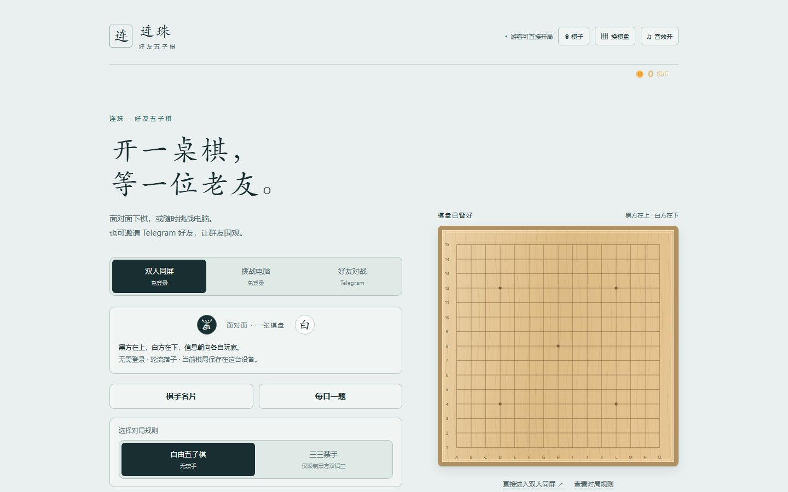

# 连珠 · 好友五子棋 · 项目介绍页

「连珠」五子棋项目的官方介绍站点：展示玩家端、联机服务端与管理后台的功能全景，以及 31 张本地真实运行截图。

- 线上地址：<https://marc-mal.github.io/Gomoku-intro/>
- 本仓库只包含**介绍页**（Vue 3 + Vite 静态站点），游戏源码不在此仓库。



## 功能一览

### 对局

- **双人同屏**：一部设备两人轮流落子，黑方在上、白方在下，信息朝向各自玩家；棋局保存在本机，离线、免登录。
- **人机对战**：简单 / 中等 / 终极三档难度，玩家执黑先行；终极难度在 Web Worker 中多步推演，界面不卡顿。
- **好友联机**：10 位房间号或 Telegram 深链进房，WebSocket 实时同步；支持观战与语音喝彩。
- **计时规则**：每方 10 分钟、每步 60 秒，超时判负。
- **对局操作**：悔棋、求和、认输、离开座位，棋谱可回看与导出。
- **棋盘体验**：棋盘主题与棋子皮肤。

### 服务端权威

- 落子只提交索引，棋盘由服务端按棋谱重建，不信任客户端棋盘。
- 悔棋、求和、认输、超时判负走同一套协议，棋谱落库可回看。
- 15×15 连珠棋盘，含三三禁手判定。

### 社交与成长

- 棋手名片：胜局、胜率、最高连胜、棋币余额。
- 段位星数与排行榜、每日一题、称号衣柜与头像框、成就册。
- 同桌比分与历史交手、本桌擂台与观众喝彩。
- 终局生成战报 PNG，可直接分享。

### 运营后台

- 用户与房间管理、题库与台词管理、段位调整与批量发奖、公告管理。
- 棋币兑换码、提现方式与提现订单审核。
- 管理员、角色与 26 个权限点（RBAC）、审计日志。
- 站点配置、定时任务、系统信息、数据清理。

### Telegram 群对战

- 群里发送 `/pk` 直接建桌，Bot 以发起人的 Telegram 身份开局；同一群 30 分钟内复用未开局的房间。
- 群友点「加入对局」通过 Mini App 深链（`startapp=room_{id}`）进同一张桌，无需手输房间号。
- 支持落座、观战、语音喝彩与战报分享。

### 棋币与押注

- 兑换码获取棋币，押注局托管押金，提现走后台审核。
- 押注与提现可在站点配置中一键关闭。

## 三端架构

| 模块 | 职责 | 技术栈 |
| --- | --- | --- |
| `@gomoku/core` | 棋盘、胜负判定、三三禁手、回放、AI、协议常量 | TypeScript · 纯函数 |
| 玩家端 | 本地同屏 / 人机 / 好友联机三种模式，离线 AI 在 Web Worker 运行 | Vue 3 · Pinia · Vite |
| 服务端 | REST + WebSocket、房间状态机、社交、榜单、后台接口、Telegram Bot | NestJS 12 · MySQL / Redis |
| 管理后台 | 运营页面、RBAC、审计、站点配置、提现审核 | vue-vben-admin · Ant Design Vue |

- 玩家端与服务端共用同一份规则内核，核心逻辑只写一次。
- 存储支持 MySQL（棋谱 / 社交 / 后台数据）、Redis（房间态 / 跨进程广播，可选）与内存实现（单机默认，测试无需外部存储）。
- 三端通过明确的 HTTP / WebSocket 契约连接。

## 快速开始（介绍页本身）

需要 Node.js 20+。

```bash
# 安装依赖
npm install

# 本地开发（默认 http://localhost:5173）
npm run dev

# 生产构建，产物在 dist/
npm run build

# 预览构建产物（http://localhost:4173）
npm run preview
```

## 目录结构

```
.github/workflows/deploy-intro.yml  GitHub Pages 自动部署
public/shots/                       31 张真实截图（玩家端 10 + 管理后台 21）
scripts/capture.mjs                 截图采集脚本
src/data/content.js                 全站文案与截图清单（唯一来源）
src/components/                     页面区块组件
src/directives/reveal.js            滚动入场指令
```

## 修改内容

- **文案与截图清单**：编辑 [src/data/content.js](src/data/content.js)；统计数字、功能分组、截图标题都在这里。
- **新增截图**：图片放入 `public/shots/`，并在 `src/data/content.js` 的 `shotGroups` 中登记文件名。
- **联系方式**：`telegramContact` 的 `handle` 与 `url`；`url` 留空时页面显示「链接待填写」。
- **重新采集截图**：先启动三端（server 3000 / player 5173 / admin 5666），再执行

  ```bash
  node scripts/capture.mjs
  ```

  Playwright 不是项目依赖，脚本会按 `PLAYWRIGHT_DIR` → 项目 `node_modules` → npx 缓存 的顺序查找；服务地址与后台账号可用 `PLAYER_URL` / `ADMIN_URL` / `API_URL` / `ADMIN_USER` / `ADMIN_PASSWORD` 覆盖。

## 部署

推送到 `master` 或 `main` 触发 GitHub Actions，构建后发布到 GitHub Pages。

首次部署需在仓库 `Settings → Pages → Build and deployment` 把 `Source` 设为 **GitHub Actions**。默认 `GITHUB_TOKEN` 没有仓库 admin 权限，`configure-pages` 的 `enablement: true` 无法自动创建 Pages 站点。

`vite.config.js` 使用 `base: './'`，页面在 `/<repo>/` 子路径下也能正常加载。

## 联系

源码购买与项目咨询：Telegram [@marc_mal](https://t.me/marc_mal)
